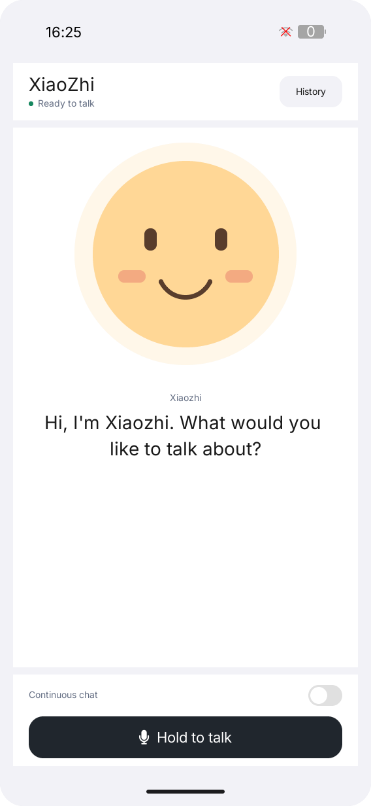
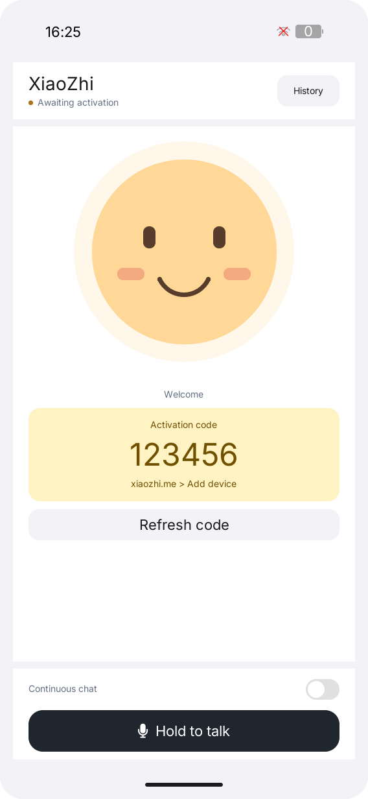
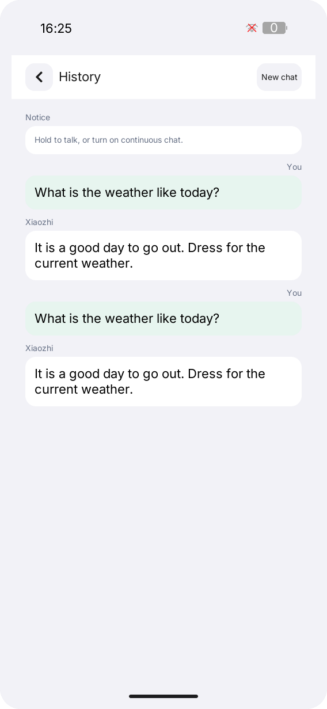

# LILYGO XiaoZhi

**English** | [简体中文](README.zh-CN.md)

LILYGO XiaoZhi is a voice assistant client for LILYGO UI, built with C++17,
[LILYGO UI AppKit](https://github.com/LILYGO-UI/cm0-appkit), and LVGL 9.5.
It connects to services compatible with the XiaoZhi protocol over WebSocket
and uses Opus for voice transmission.

The project provides a CM0 ARM64 Linux device build with ALSA audio and an
SDL2 desktop simulator for development and testing. Interface controls are in
English; transcripts and assistant replies retain the language returned by the service.

## Preview

<p>
  
  
  
</p>

These previews are generated by offline tests. Rendering tests also cover
landscape and embedded layouts.

## Features

- **Device pairing:** automatic OTA activation with a six-digit code for
  [xiaozhi.me](https://xiaozhi.me), followed by a saved connection and device identity.
- **Voice conversation:** touch push-to-talk, optional continuous conversation
  with local voice activity detection (VAD), and standard Linux microphone keys.
- **Conversation controls:** interrupt a reply, read the current caption or full
  session history, and start a new chat.
- **Expressions:** native LVGL facial expressions respond to recording, playback,
  and emotion events from the service.
- **Connection recovery:** automatic retries after session exits, with a delay
  increasing from 2 to 20 seconds, plus a manual reconnect command.
- **Responsive interface:** portrait `568 x 1232`, landscape `1232 x 568`, and
  smaller parent containers, with space reserved for system UI.

Real conversation requires internet access, a compatible service, and working
audio input/output. Continuous conversation is half-duplex: the microphone resumes
after reply playback drains. Optional wake-word support requires compatible KWS
resources; CM0 does not include the K230 wake-word stack or full-duplex acoustic
echo cancellation (AEC). See [runtime configuration](docs/03-runtime-configuration.md)
(Chinese) for these limits and available settings.

## First Conversation

1. Connect the device to the network and open **XiaoZhi**, or start the desktop
   simulator using the instructions below.
2. In the [xiaozhi.me](https://xiaozhi.me) console, choose **Add device**.
3. Enter the six-digit code displayed by the application. It obtains the code
   automatically from the official OTA service.
4. After pairing, the application saves the returned WebSocket address and token
   and connects to a voice session. Subsequent launches reuse the saved connection.

| Control | Behavior |
| --- | --- |
| **Hold to talk** | Hold the microphone button to record; release when it shows **Release to send**. |
| **Continuous chat** | Enable local VAD to send each utterance after a pause and listen again after the reply. Disable it to stop automatic listening. |
| **Stop** | Interrupt the current turn. During a reply, holding the microphone also interrupts and prepares a new recording; releasing it before recording starts cancels that recording. |
| **History** / **New chat** | Read the current session history, or clear it and create a new protocol session. Closing the history panel preserves its contents. |
| **Reconnect** / **Refresh code** | Retry the connection or obtain a new pairing code. |

Recording or connection errors turn off continuous conversation; enable it again
when ready. Hardware keys and wake-word behavior are documented in
[runtime configuration](docs/03-runtime-configuration.md).

## Development Environment

Project identity, version, and package metadata come from [`lpm.toml`](lpm.toml).
[`CMakePresets.json`](CMakePresets.json) defines `host-simulator` and `cm0-cross`.
Run all project commands from the repository root.

### Get the Source

```sh
git clone --recurse-submodules https://github.com/LILYGO-UI/lilygo-ui-xiaozhi.git
cd lilygo-ui-xiaozhi
```

For an existing checkout, initialize the pinned dependencies:

```sh
git submodule update --init --recursive
```

AppKit is consumed directly from `third_party/cm0-appkit`; the simulator does not
require a separate AppKit installation. Both presets use its bundled LVGL 9.5.0
archive with LVGL network fetching disabled.

### Host Dependencies

Use CMake 3.21 or later (including CTest and CPack), Python 3.11 or later for LPM,
and a C/C++ compiler with C++17 support. The presets use Unix Makefiles.
SDL2 supplies the display and audio, FreeType renders fonts, OpenSSL handles TLS,
and Opus encodes and decodes voice. AppKit also uses `patch` for its LVGL patches.

#### Debian 12 / Ubuntu 24.04 or Later

```sh
sudo apt update
sudo apt install build-essential cmake git pkg-config patch libsdl2-dev \
  libfreetype6-dev libssl-dev libopus-dev ca-certificates curl \
  python3 python3-venv python3-pip
```

On older distributions, upgrade CMake and Python to the minimum versions above.
The simulator uses SDL2 audio; ALSA development files are needed in the device SDK.

#### macOS

Install the Xcode Command Line Tools if needed and dependencies through
[Homebrew](https://brew.sh/). Complete its shell setup so that `brew` and the
installed tools are on `PATH`:

```sh
xcode-select --install
brew install git cmake pkg-config patch sdl2 freetype openssl@3 opus curl python
```

#### LPM

CMake invokes `lpm metadata --format cmake` during configuration. Install LPM
in a project-local environment using Python 3.11 or later:

```sh
python3 -m venv .venv
. .venv/bin/activate
python -m pip install "git+https://github.com/LILYGO-UI/lpm.git"
lpm --version
```

Reactivate the environment with `. .venv/bin/activate` in each new terminal.
CMake searches `.venv/bin` as well as `PATH`; use
`-DLPM_EXECUTABLE=/absolute/path/to/lpm` during configuration to select another
installation.

Check the host environment before building:

```sh
cmake --version
python --version
pkg-config --modversion sdl2 freetype2 openssl opus
lpm metadata --format cmake
```

### Device Cross Compiler

Skip this step when only building the simulator. Device builds require a separate
AArch64 Linux cross compiler on the development machine.

**Debian / Ubuntu:**

```sh
sudo apt install gcc-aarch64-linux-gnu g++-aarch64-linux-gnu
```

**Apple Silicon macOS:**

```sh
brew install aarch64-unknown-linux-gnu dpkg
```

The SDK preparation script uses `dpkg-deb`, normally provided by `dpkg` on
Debian / Ubuntu. The BSP expects these compiler names on `PATH`:

```sh
aarch64-linux-gnu-gcc --version
aarch64-linux-gnu-g++ --version
```

See [CM0BspBuilder](https://github.com/LILYGO-UI/CM0BspBuilder) for supported host
and compiler requirements. The BSP provides target headers and libraries, not
the host cross compiler.

## Build and Test

After completing environment setup, use LPM from the repository root. It reads
the build presets and package output directory from `lpm.toml`.

### Desktop Simulator

```sh
lpm start --foreground
```

This configures, builds, and runs the simulator in the foreground. Reuse an
existing build with `lpm start --no-build --foreground`. The Debug build enables
tests and is stored in `build/host-simulator`. Running requires a graphical
desktop session; real voice also needs microphone permission, audio devices,
working DNS, internet access, and CA certificates.

Normal startup performs real pairing and connects to the service. The simulator
saves its identity in the project's `.xiaozhi/device.conf` and its connection in
`.xiaozhi/connection.conf`, independent of the launch working directory.
The ignored `.xiaozhi/` directory uses mode `0700`, with configuration files at
`0600`. Do not publish its contents.

For an offline interface preview, explicitly enable the simulator's mock session:

```sh
LILYGO_XIAOZHI_MOCK=1 lpm start --foreground
```

This supplies simulated conversation events, not an offline voice assistant.
For a local microphone, Opus, and playback check without contacting a service:

```sh
build/host-simulator/lilygo-ui-xiaozhi-helper audio-loopback --seconds 1
```

### Tests

Configure and build the host simulator, then run the full test suite:

```sh
lpm test
```

| Test | Coverage |
| --- | --- |
| `xiaozhi-core` | Session states, transcript rules, and pairing-code validation without LVGL |
| `xiaozhi-view-model` | User commands, Subjects, push-to-talk, and continuous conversation |
| `xiaozhi-session` | Helper lifecycle, activation, persistence, restart recovery, and event parsing |
| `xiaozhi-audio-capture` | SDL partial reads, timeouts, cancellation, and playback drain |
| `xiaozhi-helper-identity` | Stable device identity and valid Client ID formatting |
| `xiaozhi-protocol-session` | Real helper against a local WebSocket server and simulated audio |
| `xiaozhi-render-{portrait,landscape,embedded}` | Main conversation layout and interactions |
| `xiaozhi-render-history-{portrait,landscape,embedded}` | Conversation history layout and interactions |
| `xiaozhi-render-binding-{portrait,landscape,embedded}` | Pairing-code layout and activation states |

The brace groups represent three tests each, for 15 tests in total. Tests use
mock helpers or audio and a local WebSocket peer; they require no service token,
external network access, or microphone permission.

Rendering tests write `xiaozhi-*.ppm` under `build/host-simulator`, covering
`568 x 1232`, `1232 x 568`, and an embedded parent. Inspect these outputs after UI
changes; passing assertions do not verify visual layout. See the
[UI development guidelines](docs/01-user-interface.md) (Chinese).

### CM0 Device Build

The device preset targets CM0 Raspberry Pi OS on AArch64, uses Release mode,
disables host tests, and installs under `/usr`.

CM0 BSP `0.1.0` includes ALSA development files and OpenSSL runtime libraries,
but needs OpenSSL development files and Opus before the protocol helper can be
built. Prepare the SDK, then build and package:

```sh
python3 scripts/prepare-helper-sdk.py
lpm pack
```

The [preparation script](scripts/prepare-helper-sdk.py) downloads the pinned BSP
through the [toolchain wrapper](cmake/cm0-bsp-toolchain.cmake) when needed, then
downloads fixed Debian ARM64 packages. Both stages verify SHA-256 checksums.
It extracts target files into `.cache/cm0-bsp/0.1.0/sysroot` and caches additional
packages in `.cache/helper-sdk-packages`; it does not install Linux libraries on
the development machine. The first run requires access to GitHub Releases and
`deb.debian.org`, plus Python 3, CMake, `curl`, and `dpkg-deb`.

Later runs reuse the cache. Rerun preparation after clearing the SDK cache.
The script currently uses the project-local sysroot path; changing
`CM0_BSP_CACHE_DIR` in CMake does not redirect it. No sibling BSP checkout is
required, and host libraries cannot replace missing target dependencies.

The `cm0-cross` preset requires `LILYGO_XIAOZHI_BUNDLED_HELPER=ON` and fails if
helper dependencies are missing. Use `AUTO` or `OFF` only for a target with a
separately supplied compatible helper; CM0 does not include the legacy K230 helper.
See [helper selection](docs/03-runtime-configuration.md) for runtime overrides.

CPack writes an ARM64 `.deb` to `dist/`. It contains the application,
`/usr/libexec/lilygo-ui-xiaozhi-helper`, launcher entry and icon, desktop entry,
AppStream metadata, and font license notices. Device dependencies include
`lilygo-ui-appkit-dev >= 0.1.0`, `libssl3`, `libasound2`, `libopus0`, and
`ca-certificates`. AppKit provides the shared runtime fonts.

Transfer the generated package to the CM0 device, then install it with APT to
resolve dependencies. Use the actual package filename if the version changes:

```sh
sudo apt install --reinstall ./lilygo-ui-xiaozhi_0.1.0_arm64.deb
/usr/libexec/lilygo-ui-xiaozhi-helper --help
```

<details>
<summary>Underlying CMake commands</summary>

LPM wraps the following steps. Direct CMake configuration still requires LPM to
read project metadata.

Host build and tests:

```sh
cmake --preset host-simulator
cmake --build --preset host-simulator --parallel
ctest --preset host-simulator
```

Device build and packaging:

```sh
python3 scripts/prepare-helper-sdk.py
cmake --preset cm0-cross
cmake --build --preset cm0-cross --parallel
cpack --config build/cm0-cross/CPackConfig.cmake -B dist
```

</details>

### Troubleshooting

| Symptom | Action |
| --- | --- |
| `lpm is required to read project metadata` | Install LPM in `.venv`, put it on `PATH`, or set `LPM_EXECUTABLE`. |
| `LilyGoUI` or bundled LVGL cannot be found | Run `git submodule update --init --recursive`. |
| SDL2, FreeType, OpenSSL, or Opus is missing | Install the host development packages; for a device build, prepare the target SDK. |
| Homebrew libraries are not found | Configure with `cmake --preset host-simulator -DCMAKE_PREFIX_PATH="$(brew --prefix)" -DOPENSSL_ROOT_DIR="$(brew --prefix openssl@3)"`. |
| `Bundled Xiaozhi helper requested but dependencies are missing` | Run `python3 scripts/prepare-helper-sdk.py` and configure again. Check for a custom BSP cache path. |
| BSP or dependency download fails | Check GitHub Releases / Debian connectivity, disk space, and `curl` / `dpkg-deb` availability, then rerun preparation. |
| Device reports a missing helper | Check `dpkg -L lilygo-ui-xiaozhi` and `ldd /usr/libexec/lilygo-ui-xiaozhi-helper`, install the complete package with APT, then reopen or reconnect. |
| Pairing, recording, or playback fails | Check connectivity, microphone permission, and audio-device selection; see [runtime troubleshooting](docs/03-runtime-configuration.md). |

## Documentation

The detailed guides are currently in Chinese.

| Guide | Contents |
| --- | --- |
| [Architecture overview](docs/00-overview.md) | Module boundaries, events, process lifecycle, and recovery |
| [UI development guidelines](docs/01-user-interface.md) | Typography, layout, ownership, and UI validation |
| [Linux reference and CM0 adaptation](docs/02-linux-reference.md) | Upstream interaction references, screen geometry, and device audio |
| [Runtime configuration](docs/03-runtime-configuration.md) | Pairing, protocol helper, environment variables, identity, storage, and audio troubleshooting |

## Acknowledgments

The protocol implementation follows the XiaoZhi implementation in T-Display
K230 `k230_launcher` at commit `bb831ab358b66f5bd9a87ecd7c580fee4537492e`.
Interaction and state-flow references come from
[100askTeam/xiaozhi-linux](https://github.com/100askTeam/xiaozhi-linux/tree/9eff7f419122d2ba0a7ec70bd669edfc72dd9066).
The application retains its own AppKit and MVVM architecture. Its interface uses
LILYGO UI AppKit and [LVGL](https://lvgl.io/), with pairing through
[xiaozhi.me](https://xiaozhi.me). See the [adaptation guide](docs/02-linux-reference.md)
for the scope of these references.
